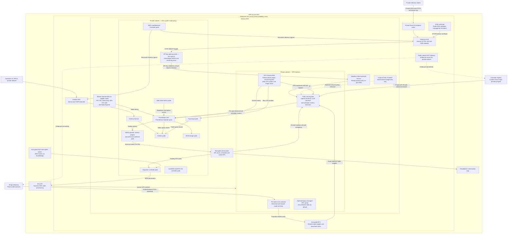
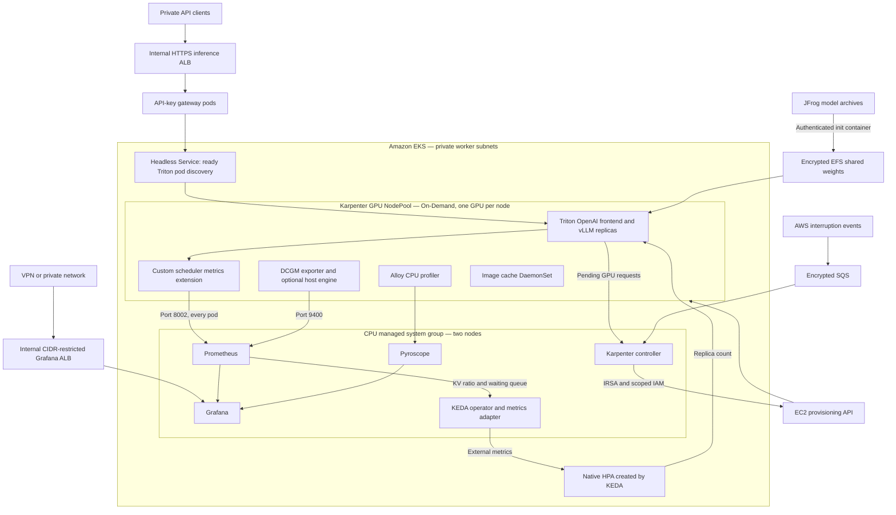
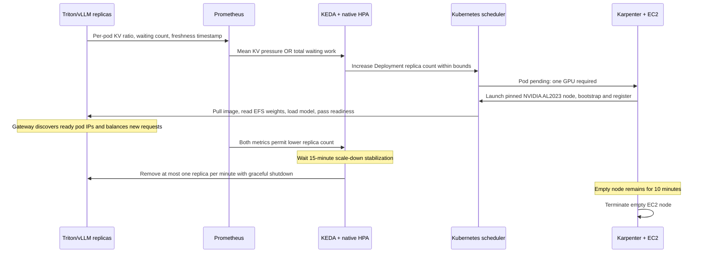
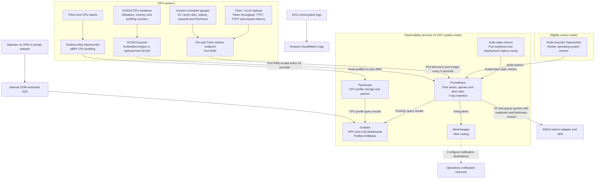

# Architecture and Terraform implementation

## Resource layout

```text
infra/                         AWS infrastructure Terraform root
  versions.tf                  AWS and TLS provider pins
  variables.tf                 Region, network, EKS, GPU sizing, operator access
  network.tf                   VPC, 3 public/private AZ subnets, IGW, NAT, EFS
  eks.tf                       EKS control plane, IAM/IRSA, access, add-ons, GPU node group
  autoscaling.tf               CPU system nodes, Karpenter IAM/SQS/access and outputs
  outputs.tf                   Values consumed by the workloads root
  terraform.tfvars.example     Non-secret example values

workloads/                     Kubernetes/Helm Terraform root
  versions.tf                  AWS, Kubernetes and Helm providers
  variables.tf                 Cluster/EFS inputs, model URLs, model choice, secrets
  models.tf                    EFS PV/PVC, Artifactory pull, Triton and Service
  autoscaling.tf               Karpenter/KEDA charts, NodeClass/NodePool and ScaledObject
  autoscaling-variables.tf      Autoscaling inputs, limits and metric targets
  image-cache.tf               Opportunistic image cache and disruption budget
  inference.tf                 API-key gateway, network policy, HTTPS ALB, ACM and DNS
  inference-variables.tf       Endpoint, validation zone, CIDRs, keys and timeouts
  gateway/                     NGINX proxy and sensitive API-key map templates
  charts/resources/            Apply-time custom-resource rendering after CRDs
  observability.tf             NVIDIA plugin/DCGM, Prometheus/Grafana, Pyroscope
  prometheus.yml               Prometheus Triton/vLLM and DCGM scrape jobs
  dashboards/llm-gpu-profiling.json
                               Provisioned Grafana GPU profiling and KV-cache panels
  terraform.tfvars.example     Model artifact URLs and non-secret inputs

images/triton-metrics/         Custom metrics extension and image build
autoscaling.md                 Autoscaling operations and maintenance
inference.md                   HTTPS endpoint, API keys, streaming and DNS operations
concept.md                     Background and design decisions
operation.md                   Deploy, operate, switch, scale and tear down
architecture.md                This document
README.md                      Entry point
```

## Deployment sequence

1. **VPC:** Create a dedicated VPC with three public and three private subnets across available AZs, an Internet Gateway, a single NAT Gateway, and subnet route tables. The single NAT is a cost-conscious starting topology; it is an AZ-level dependency and may incur cross-AZ data costs. For production resilience, use one NAT per AZ or VPC endpoints where suitable.
2. **EKS control plane:** Create a standard managed EKS cluster, private and restricted public API access, control-plane logging, operator access entry, IAM role and core networking add-ons.
3. **Worker and persistent storage:** Create two CPU system workers and retain the optional legacy GPU managed group at zero desired capacity. Provision Karpenter IRSA/node IAM, EKS node access and interruption handling. Create encrypted EFS, mount targets and security group; install the EFS CSI EKS add-on with IRSA.
4. **Workloads root:** Configure AWS auth against the cluster only after infra apply completes. Install Karpenter and KEDA on system nodes and apply the GPU NodeClass/NodePool. Provision the API-key gateway, backend ingress policy, dedicated HTTPS inference ALB, ACM certificate/validation and private DNS. Install NVIDIA's device plugin, DCGM exporter, Pyroscope, and kube-prometheus-stack. Create the static EFS PV/PVC. Triton's init container downloads the three archive URLs into EFS; Triton is scheduled only after a GPU resource is advertised and starts the configured selected model.

Terraform's graph orders resources inside each root. The separate apply boundary is deliberate: Terraform provider initialization cannot reliably wait for resources in the same configuration to make a newly created cluster/API endpoint and joined nodes ready. The workload root also sets explicit dependencies for the device plugin, storage claim, and monitoring components.

## GPU node pool and AMI

The managed node group is not bare metal. It is an EC2 accelerated instance group registered to the AWS-managed EKS control plane. The default is `g7.8xlarge`; alternatives are set through `gpu_instance_type`. The node group has `gpu_min_size`, `gpu_desired_size`, and `gpu_max_size` variables. The legacy managed GPU group defaults to zero desired/minimum and one maximum. Dynamic capacity comes from Karpenter, not these managed-group settings. Increase capacity only after testing memory, cost, and scheduling. A pod requesting `nvidia.com/gpu: 1` is scheduled only when the NVIDIA device plugin advertises a free GPU.

The GPU worker role includes `AmazonSSMManagedInstanceCore` for IAM-controlled Systems Manager Session Manager access. Nodes remain private, with no inbound SSH rule or SSH key pair. The private-subnet NAT route provides outbound SSM connectivity. An opt-in SSM State Manager association (`install_dcgm_cli`) detects the installed CUDA user-mode version, installs the matching NVIDIA DCGM package, and starts the host engine. When enabled, the workloads root's `use_host_dcgm_engine` flag configures DCGM Exporter to connect to that host engine; keep the flags aligned. The default remains the exporter's embedded engine and does not install host packages.

The AL2023 NVIDIA EKS AMI includes the host driver, CUDA user-mode driver, and NVIDIA Container Toolkit; the NVIDIA device plugin remains a cluster add-on for this managed node group. AWS recommends DRA for some newer Kubernetes configurations, but this deployment uses the mature `nvidia.com/gpu` device-plugin resource interface for compatibility. See [AWS EKS GPU device management](https://docs.aws.amazon.com/eks/latest/userguide/device-management-nvidia-dra-device-plugin.html).

## Storage and model repository

EFS is encrypted and mounted read/write by the Triton pod. The CSI driver uses IRSA for AWS API operations. A static persistent volume refers to the filesystem ID; it retains downloaded model assets independently of the pod. EFS throughput, storage size, backup policy, and lifecycle policy should be sized and governed for the organization's workload.

The init container reads three direct HTTPS URLs and a bearer token from a Kubernetes Secret. It downloads each archive only when its `.download-complete` marker is absent. If an archive changes at the same URL, delete its marker/cache directory or use a versioned immutable URL. For production supply checksums and verify them before extraction. The model archive should contain the HF model files at its root; the model repository and `model.json` are generated by Terraform.

The selected-model flag uses Triton's explicit model control: all three models are described in the model repository but only one is loaded at startup. Switching the selected model changes the deployment and reloads Triton; rolling updates use one extra GPU to preserve serving availability when capacity permits. Each Triton replica requests a whole GPU; replicas do not share GPU memory. EFS allows multiple pods to read the same weights but does not create GPU memory.

## Inference and request path

The `triton-vllm` pod runs NVIDIA's bundled OpenAI-compatible frontend, which starts an in-process Triton server and routes OpenAI requests into the selected vLLM backend model. It uses the model's tokenizer from the same EFS-cached archive. The `triton-vllm` ClusterIP Service exposes:

| Port | Protocol | Use |
| ---: | --- | --- |
| 8000 | HTTP | OpenAI-compatible API (`/v1/models`, `/v1/completions`, `/v1/chat/completions`) and readiness endpoint; targets container port 9000 |
| 8002 | HTTP | Triton metrics endpoint (`/metrics`) on the in-process Triton server; includes native vLLM custom metrics when enabled |

The vLLM Triton backend expects decoupled model transactions and uses `model.json` as vLLM engine arguments. The model config enables custom vLLM metrics. Streaming chat completions are supported by the frontend/backend combination. The Terraform-managed inference path is a dedicated internal HTTPS ALB → API-key gateway → ready Triton pods through a headless Service. Two unprivileged NGINX gateway replicas validate bearer keys and select a ready pod for each request using dynamic DNS and least-connections balancing. The original ClusterIP is retained for administrative diagnostics; network policy restricts the backend API to gateway pods and metrics to Prometheus. VPC CNI policy support is enabled in infra. Manage keys in a secret store and restrict Terraform state and Kubernetes Secret access; see [inference.md](inference.md) for policy enforcement boundaries, rotation and streaming behavior.

Grafana is exposed separately through an internal Application Load Balancer. The AWS Load Balancer Controller is installed by the workloads root and assumes a dedicated IRSA role created by the infra root. The ALB allows only the configured `grafana_ingress_cidrs`; access requires VPN or another private route into the VPC. The starter listener is HTTP-only, suitable only for a trusted private network. Production should use HTTPS with a private ACM certificate and a private DNS name.

## Telemetry data path

- `workloads/prometheus.yml` is the source of the additional scrape jobs passed to kube-prometheus-stack. Terraform renders the configured Kubernetes namespace into this file before Helm installation.
- The `triton-vllm` job discovers and scrapes every Triton pod IP on port 8002 every five seconds. This is the in-process Triton server's metrics endpoint and includes Triton metrics plus the vLLM metric subset forwarded by the backend (prompt/generation tokens, TTFT, time-per-output-token, end-to-end latency, and request-parameter histograms). The stock backend omits KV gauges; the project custom image adds scheduler KV usage, waiting requests and a freshness timestamp. Preemption metrics remain unavailable.
- The `dcgm-exporter` job discovers pods in `observability`, selects the NVIDIA DCGM exporter, and scrapes port 9400. Its Terraform-managed custom collector includes GPU utilization/memory plus tensor, SM-active, DRAM-active, and FP16 profiling metrics; Grafana provisions a dedicated LLM GPU profiling dashboard for these fields.
- kube-prometheus-stack supplies Prometheus, Grafana, alerting components, node exporter, and Kubernetes metrics integrations.
- Pyroscope stores profile data and is configured as a Grafana datasource. A Grafana Alloy eBPF DaemonSet runs as root with host PID access on GPU nodes and filters its discovered targets to the Triton pod. This provides software CPU profiles and requires elevated host access. DCGM is the GPU hardware telemetry path; Pyroscope/eBPF is not a GPU kernel profiler.

Prometheus and Grafana persistence/retention should be explicitly sized for production. Grafana is exposed through an internal ALB created by AWS Load Balancer Controller and restricted to `grafana_ingress_cidrs`; reach it through a VPN or private connection into the VPC. The starter ALB listener uses HTTP, so configure a private ACM certificate and HTTPS listener before using untrusted networks. The current chart configuration uses short Prometheus retention and chart defaults for small-scale evaluation. Consider EBS-backed PVCs, backups, authentication integration, retention, and alert destinations before production.

## Trust boundaries and secrets

- AWS authentication is the local AWS CLI/profile/role used by Terraform; no long-lived AWS keys belong in `.tfvars`.
- EKS API access uses the declared IAM `cluster_admin_arn` access entry and the operator's AWS credentials.
- JFrog authorization is sent only by the init container to the provided HTTPS artifact URLs.
- Terraform's `sensitive` marker only redacts output. The token is stored in Terraform state and as a Kubernetes Secret. Treat both state and cluster API data as secret-bearing, encrypt and restrict them, and rotate credentials.
- The public EKS API is restricted by `admin_cidr_blocks`; nodes and both ALBs remain private. Inference HTTPS access is restricted by `inference_ingress_cidrs` and bearer keys. Backend network policy is not an isolation boundary against node/cluster administrators or privileged host-network access.

## Validation checklist

Use these checks to validate the deployment with the selected image, model artifacts, and configured AWS infrastructure. These are validation criteria, not a report of completed validation results. Also verify replica scale-out and scale-down using the procedures in [autoscaling.md](autoscaling.md#deployment-and-migration-checklist).

| Area | Validation required |
| --- | --- |
| GPU capacity | Confirm sufficient G-series On-Demand quota and instance capacity in the selected AZs, and verify GPU workers are provisioned. |
| GPU scheduling | Confirm nodes are Ready, the NVIDIA device plugin advertises allocatable GPUs, and pod GPU requests and node selectors allow scheduling. |
| EFS storage | Confirm the PVC is Bound and pods can mount EFS; verify CSI add-on/IRSA, NFS port 2049 access, mount targets, routing, and filesystem ID. |
| Model artifact download | Verify HTTPS URL paths, bearer token scope and expiry, TLS trust, archive format and size, and Artifactory reachability from private subnets. Confirm the init container completes. |
| Model initialization | Verify archive layout, tokenizer and weight files, model architecture and quantization support, image/vLLM compatibility, and GPU memory/context settings. Confirm the selected model becomes ready. |
| OpenAI frontend | Confirm the image contains `python/openai/openai_frontend/main.py`, required dependencies, and a valid local tokenizer directory. Verify the frontend starts and serves an inference request. |
| GPU telemetry | Confirm DCGM exporter scheduling and driver compatibility, scrape labels and ports, and GPU series in Prometheus. |
| vLLM telemetry | Confirm the `triton-vllm` target is `UP`, port 8002 exposes `/metrics`, and the initialized backend emits inference metrics plus the custom scheduler KV, waiting-request, and freshness gauges. |
| Inference HTTPS endpoint | Verify ACM DNS validation, private-zone/VPN resolution, client CIDR allowlist, gateway target health, and bearer-key authentication; see [inference.md](inference.md). |
| Grafana access | Confirm the ingress receives an ALB hostname and Grafana is reachable from an allowed private client. Verify Load Balancer Controller health, IRSA permissions, private subnet tags, target health, and `grafana_ingress_cidrs`. |

The custom image base tag is `26.04-vllm-python-py3`, which bundles vLLM 0.19 and requires a sufficiently recent NVIDIA driver (CUDA 13.2 / driver 595.58.03 in NVIDIA's compatibility matrix). This is chosen to align with current EKS NVIDIA AL2023 AMIs that bundle the R595 driver line while supporting newer model architectures. Check the actual selected AMI driver and Triton [compatibility matrix](https://github.com/triton-inference-server/server/blob/main/docs/introduction/compatibility.md) before applying. Validate the exact model architecture (in particular `qwen35_8b`) against the vLLM version and exact archive before production. Infrastructure deployment and model readiness are separate validation steps; confirm that the selected model architecture loads successfully in the pinned image.

## Top-level architecture

This view combines both Terraform-managed internal ALBs, application pods, storage, autoscaling and observability. Inference uses a dedicated HTTPS ALB with API-key gateway pods; Grafana has its own CIDR-restricted ALB. ALBs are AWS resources, not Kubernetes pods. Service boxes show logical routing/discovery: the ALBs use IP targets for gateway/Grafana pods, and the gateway discovers ready Triton pod IPs through a headless Service.



The serving pods run in the configurable namespace (default `llm-serving`); monitoring services run in `observability`, with KEDA and Karpenter in their own namespaces. GPU workers normally come from Karpenter's NodePool; the legacy managed group remains available for migration or manual capacity. Each serving pod has its own model repository and GPU model copy, while EFS shares cached weight files. Worker DaemonSets run according to their selectors and tolerations; the diagram groups chart-managed components by function rather than promising a fixed pod count or chart-specific placement.

The inference listener uses HTTPS with a Terraform-managed ACM certificate, public DNS validation and private Route 53 alias. TLS terminates at the ALB; traffic to gateway and Triton pods uses HTTP in the VPC. The separate Grafana ALB retains its existing HTTP listener. [inference.md](inference.md) documents the public parent-zone prerequisite, private DNS resolution, CIDRs, secrets and streaming/drain limits. The following sections expand the autoscaling and observability paths.

## Autoscaling architecture

These diagrams show the reference implementation. See [autoscaling.md](autoscaling.md) for all defaults, formulas, image maintenance, lifecycle ordering and migration details.





The original managed GPU node group is retained for migration/manual capacity and defaults to zero desired nodes. It is not autoscaled by Karpenter. The dynamic GPU pool uses one unordered instance allowlist, explicit pinned NVIDIA AMI, private subnet/security-group IDs, protected instance metadata, and encrypted tuned gp3 storage. System controllers remain on CPU nodes; GPU daemons tolerate the GPU taint. The CPU group is independent of demand and remains billable.

The custom image retains all original backend metrics and adds scheduler KV utilization, waiting requests and freshness. The ScaledObject owns one HPA with two independent metrics; no competing HPA or manual Terraform replica reconciliation is introduced. One serving replica remains available by policy. An external demand signal and buffering design would be required for automatic wake-up from zero.

## Observability architecture

Metrics and profiles follow separate paths into Grafana. Arrow labels identify collection methods and intervals; the metrics arrows show data flow, while Prometheus initiates the scrapes.



The Triton and DCGM scrape jobs are defined in [workloads/prometheus.yml](workloads/prometheus.yml). [workloads/observability.tf](workloads/observability.tf) installs the monitoring charts, configures Alloy's profile collection, provisions Grafana dashboards, and defines the `TritonAutoscalingTelemetryIncomplete` alert. The alert fires after two minutes of incomplete autoscaling telemetry while serving replicas are requested; notification destinations must be configured in Alertmanager.

Node Exporter runs as a DaemonSet on eligible workers. Alloy collects CPU stacks, not CUDA kernel profiles. DCGM supplies GPU hardware counters, while the custom backend supplies actual scheduler KV-cache and queue metrics. EKS control-plane logs go separately to CloudWatch; this implementation does not configure a centralized Triton application-log pipeline or distributed tracing.
