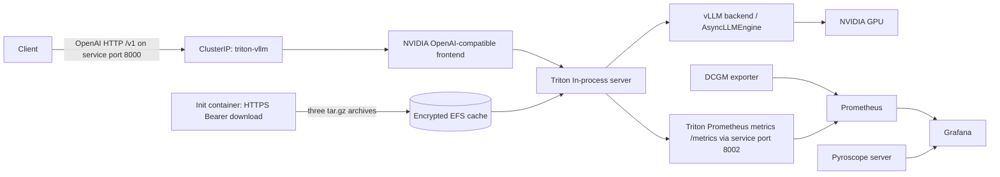

# Concept: GPU LLM inference on EKS

## What this project builds

This project provisions a standard Amazon EKS cluster with an AWS-managed Kubernetes control plane and managed EC2 GPU worker nodes. Terraform also creates a VPC, private worker subnets, NAT egress, EFS model cache, NVIDIA GPU scheduling, Triton with its vLLM backend, and a Prometheus/Grafana/DCGM/Pyroscope observability stack.

The GPU workers are **accelerated virtual EC2 instances**, not bare-metal servers. EKS still owns the control plane; AWS EC2 hosts the GPU worker nodes, and the NVIDIA EKS-optimized Amazon Linux 2023 AMI supplies the host driver/runtime pieces. The NVIDIA Kubernetes device plugin advertises `nvidia.com/gpu` to the scheduler. The Triton pod requests one GPU and therefore cannot start until a GPU worker is Ready.

The project uses two Terraform roots (`infra/` then `workloads/`). The first root builds AWS infrastructure; the second connects to the already-created cluster and installs Kubernetes resources. This makes the provider/bootstrap ordering explicit and avoids asking Kubernetes or Helm providers to operate before EKS exists.

## The serving path

Artifactory stores one `tar.gz` archive for each model. On the first pod start, the init container downloads each archive using `Authorization: Bearer …` and extracts it to EFS. Later starts reuse the cache marker. The deployment presents three Triton model entries, but loads only `selected_model` at startup. The default GPU worker has one GPU; loading all three 7B/8B models simultaneously would overcommit its VRAM. Change the selected model and apply to switch models. EFS retains the archives across pod and node restarts.

Each archive must unpack the model's Hugging Face files directly into its archive root: `config.json`, tokenizer files, and weight shards such as `*.safetensors`. The wrapper creates the Triton repository and `model.json`; do not put another enclosing directory around the archive contents.

Model aliases used by the Terraform deployment:

| Alias | Intended artifact |
| --- | --- |
| `qwen25_7b_instruct` | Qwen2.5 7B Instruct |
| `qwen35_8b` | Qwen3.5 8B (archive/model architecture must be supported by the pinned vLLM in the Triton image) |
| `llama31_8b_instruct` | Llama 3.1 8B Instruct |

The archive URL map is configurable. Terraform does not infer JFrog repository keys or artifact naming conventions; supply the direct authenticated download URLs from your JFrog generic repository.

## Triton plus vLLM: who does what

NVIDIA's bundled OpenAI-compatible frontend starts the Triton server in-process and exposes OpenAI REST endpoints such as `/v1/models`, `/v1/completions`, and `/v1/chat/completions`. The frontend converts OpenAI requests for the vLLM backend. The Triton vLLM backend delegates LLM execution to vLLM's asynchronous engine; vLLM performs paged KV-cache management and inflight/continuous batching. The Kubernetes Service remains private (`ClusterIP`); clients with cluster network access or administrators using `kubectl port-forward` can reach it. No API-key authentication is configured by default. [NVIDIA's OpenAI frontend documentation](https://github.com/triton-inference-server/server/tree/main/python/openai) and [vLLM backend documentation](https://github.com/triton-inference-server/vllm_backend) describe the components.

The backend is decoupled: one request may produce multiple streamed responses. Its model configuration must set `model_transaction_policy { decoupled: true }`. The OpenAI frontend translates chat/completions requests into the Triton vLLM backend's model inputs and handles streaming responses.

### PagedAttention

Autoregressive generation reuses key/value (KV) tensors from previous tokens. Reserving one large contiguous KV-cache region sized for the maximum output wastes memory when sequences have different lengths. PagedAttention divides a request's KV cache into fixed-size blocks and maps logical token positions to physical GPU blocks. vLLM allocates blocks as needed and can share prompt blocks for branching requests. This reduces fragmentation and allows concurrent sequences to make better use of limited GPU memory; it does not remove the memory cost of the model weights or KV cache.

### Continuous (inflight) batching

Traditional static batches wait for the longest request to finish, leaving slots idle when shorter sequences complete. Continuous batching updates the active batch at generation iterations: completed requests leave and queued requests can enter while other requests continue. This improves GPU occupancy under mixed prompt/output lengths. Paged KV blocks let vLLM add and remove active requests without relocating every other request's cache.

Together these mechanisms make a GPU serve concurrent requests more efficiently. Tune `gpu_memory_utilization` and `model_max_len` against actual context lengths and concurrency; raising context length increases KV-cache demand. The supplied `0.88` utilization is a starting point, not a guaranteed optimum.

## GPU sizing and cost model

Specifications below are for the requested single-GPU sizes. GPU memory is often quoted by vendors in decimal GB while tools report GiB; the distinction explains apparent differences.

| Instance | GPU | GPU memory | vCPU | Host RAM | Approx. on-demand Linux cost, us-east-1 |
| --- | --- | ---: | ---: | ---: | ---: |
| `g7.8xlarge` (preferred) | 1× NVIDIA RTX PRO 4500 Blackwell Server Edition | 32 GiB | 32 | 128 GiB | about $4.09/hour; about $2,983 for 730 hours |
| `g6.8xlarge` | 1× NVIDIA L4 | 24 GB | 32 | 128 GiB | about $2.18/hour; about $1,595 for 730 hours |
| `g5.4xlarge` | 1× NVIDIA A10G | 24 GB | 16 | 64 GiB | about $1.62/hour; about $1,186 for 730 hours |

AWS's current [EC2 accelerated-instance specification table](https://docs.aws.amazon.com/ec2/latest/instancetypes/ac.html) lists `g7.8xlarge` with a 32 GiB RTX PRO 4500 GPU. The approximate cost figures are a us-east-1 Linux on-demand snapshot from [CloudParity's G7 page](https://cloudparity.io/pricing/aws/g7.8xlarge), [EC2Info's G6 page](https://ec2info.app/g6.8xlarge), and [CloudParity's G5 page](https://cloudparity.io/pricing/aws/g5.4xlarge); check the AWS Pricing Calculator for your account, region, and purchase option before deployment. Availability, quotas, capacity, and actual rates vary by region and AZ. Set `gpu_instance_type` in `infra/terraform.tfvars` to choose an alternative.

The GPU node is only one part of the bill. Also estimate the EKS cluster-hour charge, NAT Gateway hours and data, EFS storage/throughput, CloudWatch control-plane logs, public IPv4 addresses, image/model data transfer, and Prometheus storage. A continuously running GPU node dominates cost; scale the managed node group to zero when the GPU is not needed, while understanding that serving is then unavailable until it scales up.

The `g7.8xlarge` has the most VRAM of the three listed choices and is the configured default. For cost-sensitive development, G5 or G6 can run many 7B/8B models at quantized or reduced context settings, subject to the model's actual memory footprint. Start with one selected model and validate workload performance before increasing concurrency or adding GPUs.

## Observability and profiling

- **DCGM exporter** exposes NVIDIA device telemetry such as utilization, memory, temperature, and power, plus explicitly selected tensor-pipe, SM-active, DRAM-active, and FP16-pipe profiling series. The counters are interval averages; some fields can be unsupported or unavailable on a particular GPU/driver, and collecting them may multiplex hardware counter groups.
- **Triton metrics** expose inference counts/latencies, GPU/CPU telemetry, and (with the vLLM backend custom metrics switch) token and time-to-first-token statistics. Prometheus scrapes `/metrics` through service port 8002. See [Triton metrics](https://docs.nvidia.com/deeplearning/triton-inference-server/user-guide/docs/user_guide/metrics.html) and the [vLLM backend metrics notes](https://github.com/triton-inference-server/vllm_backend).
- **Prometheus and Grafana** collect and visualize those metrics. The stack includes a community NVIDIA DCGM dashboard as a starting point.
- **Pyroscope plus Grafana Alloy eBPF** provide continuous CPU profiling for processes in the Triton pod on GPU workers. Alloy requires host PID access and privileged/root access for eBPF; the DaemonSet is restricted to the GPU node pool and relabels to Triton. This profiles CPU stacks, not CUDA kernels or GPU memory. DCGM supplies GPU hardware telemetry. For CUDA-kernel profiling, use NVIDIA Nsight Systems/Compute separately.

The starter project keeps Grafana internal as a ClusterIP service. Access it using `kubectl port-forward`; do not expose an unauthenticated dashboard publicly.

## Security model

The JFrog token is a Kubernetes Secret read by the init container. Terraform marks its input sensitive, which redacts normal CLI display, but the value is still present in Terraform state and Kubernetes API storage. Use a remote state backend with encryption, restricted IAM access, and locking; enable EKS secret encryption appropriate to your security requirements; rotate the token and Grafana password; and avoid shell history, checked-in `.tfvars`, or CI logs. The `.gitignore` excludes tfvars and state files.

The EKS public API endpoint is restricted by `admin_cidr_blocks`; replace the example default with a trusted VPN/office CIDR before apply. GPU nodes use private subnets with NAT egress. Triton has only a ClusterIP service and is not Internet-facing by default. Follow least privilege for the Terraform operator and production IAM roles.
